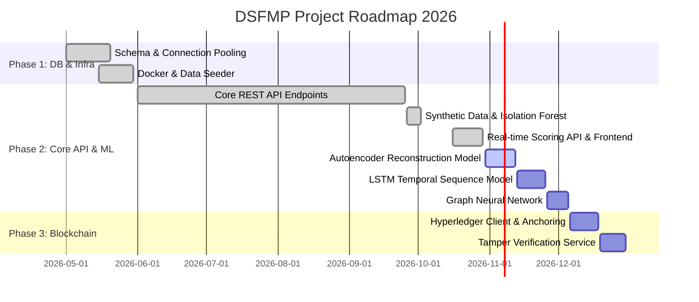

# DSFMP Fraud Detection System — Project Progress & Milestone Tracker

**Digital School Feeding Management Platform (DSFMP)**  
**Strathmore University | ICS C4 Capstone Project 2026**  
**Document Status:** Live Project Progress & Deliverables Tracker  
**Last Updated:** October 2026  
**Active Working Branch:** `feature/ml-synthetic-data-isolation-forest`  
**Repository:** [https://github.com/ErediAlvin/Fraud-System.git](https://github.com/ErediAlvin/Fraud-System.git)

---

## 1. Executive Milestone Summary

| Phase | Milestone Description | Target Completion | Current Status | Progress |
|---|---|---|---|:---:|
| **Phase 1** | **Database Schema, Infrastructure & Seeding** | May 2026 | ✅ Complete | **100%** |
| **Phase 2A** | **Core Backend REST API & Services** | June – October 2026 | ✅ Operational | **95%** |
| **Phase 2B** | **Machine Learning Anomaly Engine** | October 2026 | 🟡 In Progress | **65%** |
| **Phase 3** | **Blockchain Record Integrity & Tamper Audit** | November 2026 | 🔴 Pending | **0%** |
| **Phase 4** | **Analytical Frontend SPA (React + TypeScript)** | May – October 2026 | ✅ Operational | **92%** |
| **Overall** | **End-to-End Integrated Capstone System** | December 2026 | 🟡 Active Sprints | **75%** |

---

## 2. Sprint & Version Control Activity

### Active Working Branch
- **Branch:** `feature/ml-synthetic-data-isolation-forest`
- **Focus:** Isolation Forest model training, artifact serialization, real-time scoring integration (`/api/models/isolation-forest/infer`), transaction on-demand re-scoring (`/api/transactions/{id}/evaluate-isolation-forest`), and interactive frontend inference sandbox.

### Recent Commit History
| Commit Hash | Author | Message & Scope |
|---|---|---|
| `CURRENT` | Alvin Eredi | `feat(ml): integrate Isolation Forest v1 artifact into FastAPI scoring engine, REST endpoints, and React live inference sandbox` |
| `CURRENT` | Alvin Eredi | `fix(transactions): resolve SQL schema column mismatch (enrollment_count) and implement resilient fallback inference` |
| `7e29ebc` | Alvin Eredi | `feat(ml): implement synthetic data generation with Faker and Isolation Forest fraud model` |
| `dd45209` | Alvin Eredi | `feat: scaffold machine learning module structure with models, training scripts, and feature extraction` |
| `b249ac4` | Alvin Eredi | `docs: update README documentation` |
| `28df746` | Alvin Eredi | `Changes to the necessary files` (Supply Chain, Risk Profiles, Reports routers & Frontend pages) |
| `86d7de0` | Alvin Eredi | `feat/Systems settings module` (Settings, User management & Audit trail) |
| `75c6930` | Alvin Eredi | `The current backend API that are pulling data` |
| `dcb12ef` | Alvin Eredi | `Added front end pages for log in` |

---

## 3. Component-by-Component Status Matrix

### 3.1 Infrastructure & Persistent Data Layer (100% Complete)
- [x] **MySQL 8.0 Relational Database:** Full 24-table normalized schema with primary keys, foreign constraints, and indexes (`database/schema.sql`).
- [x] **Async Database Engine:** SQLAlchemy 2.0 with `aiomysql` connection pooling and async context manager session injection (`database/connection.py`).
- [x] **Redis 7.0 In-Memory Store:** Key-value caching, namespace isolation, and JWT revocation blacklist (`database/redis.py`).
- [x] **Docker & Compose Orchestration:** Multi-service container orchestration with automated healthchecks for MySQL, Redis, and FastAPI (`docker-compose.yml`).
- [x] **Realistic Data Seeding:** Multi-county Kenyan school feeding generator (`seed_db.py`, `seed_users.py`).

### 3.2 Backend REST API Endpoints (95% Complete)
| Module / Router | Prefix | Implemented Endpoints | Status |
|---|---|---|:---:|
| **Authentication** | `/api/auth` | `POST /login`, `POST /verify-2fa`, `POST /refresh`, `POST /logout`, `GET /me` | ✅ 100% |
| **Executive Dashboard** | `/api/dashboard` | `GET /` (KPI cards, risk distribution, 14-day trend, county concentrations, top flagged entities) | ✅ 100% |
| **Fraud Alerts** | `/api/alerts` | `GET /` (Multi-factor filter: severity, status, alert_type, search text) | 🟡 70% |
| **Case Management** | `/api/cases` | `GET /` (Kanban stage aggregation, SLA tracking)<br>`GET /{id}` (dossier, linked alerts, timeline)<br>`POST /` (create case / escalate from alert)<br>`PATCH /{id}/status` (Kanban stage transition)<br>`POST /{id}/assign` (investigator assignment)<br>`GET/POST /{id}/comments` (investigator collaboration thread) | ✅ 100% |
| **Beneficiaries Monitor** | `/api/beneficiaries` | `GET /` (Ghost student detection, enrollment statistics)<br>`POST /{id}/flag`, `POST /{id}/clear` | ✅ 100% |
| **Transactions Monitor** | `/api/transactions` | `GET /` (Audit volume, hourly distribution, search)<br>`POST /{id}/investigate`, `POST /{id}/clear`<br>`POST /{id}/evaluate-isolation-forest` (Live model re-scoring & DB persistence) | ✅ 100% |
| **Supply Chain Monitor** | `/api/supply-chain` | `GET /` (Variance metrics, delivery mismatches)<br>`GET /suppliers/{id}` (Supplier dossier, orders, schools)<br>`POST /suppliers/{id}/flag`, `POST /suppliers/{id}/clear`<br>`GET /network` (Graph network nodes and links for collusion analysis) | ✅ 100% |
| **Entity Risk Profiles** | `/api/risk-profiles` | `GET /` (Risk tiers, watchlist & suspended counts)<br>`GET /{id}` (90-day score history, radar chart multi-model breakdown)<br>`PATCH /{id}/status` (CLEAN, WATCHLIST, SUSPENDED with audit log)<br>`POST /{id}/recalculate` (On-demand score recalculation) | ✅ 100% |
| **Reports & Analytics** | `/api/reports` | `GET /` (30-day severity trends, financial exposure, resolution performance)<br>`GET /export` (Dynamic streaming CSV data download with filters) | ✅ 100% |
| **System Settings** | `/api/settings` | `GET /api/settings`, `PUT /api/settings/{cat}`<br>`GET /users`, `POST /users`, `PATCH /users/{id}`<br>`GET /audit-log` | ✅ 100% |
| **Model Performance** | `/api/models` | `GET /overview` (Model fleet statuses, health, precision, recall, AUC)<br>`GET /isolation-forest/info` (Hyperparameters, version, feature list)<br>`GET /presets` (Pre-configured test vector scenarios)<br>`POST /isolation-forest/infer` (Real-time synchronous inference on custom payloads) | ✅ 100% |
| **Operational Procedures** | `/api/procedures` | SOB / COB checklist verification & trigger endpoints | 🔴 Pending |
| **Blockchain Ledger** | `/api/blockchain` | Query blocks, audit log anchoring, verify record integrity | 🔴 Pending |

---

## 4. Machine Learning Engine Detailed Progress (Phase 2B)

### 4.1 Synthetic Dataset Generation (`ml/datasets/generate_synthetic_data.py`)
- Engineered a domain-specific dataset generator using Python `Faker`.
- Models 10,000 realistic school feeding procurement and subsidy transactions across Kenyan counties (Nairobi, Mombasa, Kisumu, Nakuru, Uasin Gishu, etc.).
- **Injected Fraud Vectors:**
  1. *Off-Hours Anomalies:* Transactions executed between 10:00 PM and 5:00 AM.
  2. *Excessive Transaction Spikes:* Amounts deviating >4x from school-tier medians.
  3. *Ghost Beneficiary Leakage:* Subsidy disbursements exceeding school enrollment counts.
  4. *Split Transactions (Structuring):* Multiple disbursements below threshold within short intervals.
- **Dataset Partitioning:**
  - `synthetic_transactions_full.csv`: 10,000 total records (5.3% fraud rate)
  - `synthetic_transactions_train.csv`: 8,000 records (80% training split)
  - `synthetic_transactions_test.csv`: 2,000 records (20% evaluation split)

### 4.2 Data Cleaning & Sanitization (`ml/features/cleaning.py`)
- `TransactionDataCleaner`:
  - Deduplication of identical transactions.
  - Normalization of negative or zero values.
  - Imputation of missing categorical variables (e.g., supplier IDs on direct parent subsidies).
  - Sanitization of zero-division ratios and infinite values.

### 4.3 Feature Engineering Pipeline (`ml/features/preprocessing.py`)
- `TransactionPreprocessor` & `TransactionFeatureExtractor`:
  - Cyclical hour transformation: $\sin(2\pi \cdot \text{hour}/24)$ and $\cos(2\pi \cdot \text{hour}/24)$.
  - Logarithmic transformations of transaction amounts: $\log_{1p}(\text{amount})$.
  - School and supplier median deviation ratios (`amount_to_school_avg_ratio`).
  - Per-student cost ratio: $\text{amount} / \text{student\_count}$.
  - Outlier-resilient feature normalization using `sklearn.preprocessing.RobustScaler`.
  - Fault-tolerant data extraction handling partial or missing fields with safe domain defaults.

### 4.4 Isolation Forest Model Evaluation (`ml/training/train_outlier_model.py`)
- **Hyperparameters:** `n_estimators=200`, `contamination=0.05`, `random_state=42`.
- **Classification Threshold:** `0.65`
- **Score Calibration:** Linear mapping of raw decision function scores to standardized $[0.0, 1.0]$.
- **Test Set Benchmark Results (2,000 Test Records with 98 Frauds):**
  - **ROC-AUC Score:** **0.9422**
  - **Precision:** **33.61%** (0.3361)
  - **Recall:** **82.65%** (0.8265 — 81 of 98 fraud records caught)
  - **F1-Score:** **0.4779**
- **Confusion Matrix:**
  - True Negatives (TN): **1,742**
  - False Positives (FP): **160**
  - False Negatives (FN): **17**
  - True Positives (TP): **81**
- **Detection Rate Breakdown by Fraud Pattern:**
  - `DISPROPORTIONATE_PER_STUDENT`: **21/21 caught (100.0%)** | Avg Score: `0.831`
  - `OFF_HOURS_DRAIN`: **16/16 caught (100.0%)** | Avg Score: `0.948`
  - `SUSPICIOUS_PAYMENT_METHOD`: **18/18 caught (100.0%)** | Avg Score: `0.846`
  - `EXTREME_AMOUNT_OUTLIER`: **15/16 caught (93.8%)** | Avg Score: `0.842`
  - `VELOCITY_BURST_SMURFING`: **7/12 caught (58.3%)** | Avg Score: `0.652`
  - `ROUND_NUMBER_DRAIN`: **4/15 caught (26.7%)** | Avg Score: `0.540`
- **Serialized Artifact:** Saved at `ml/saved_models/isolation_forest_v1.joblib` (2.8 MB).

### 4.5 Production Model Serving & Scoring Engine (`ml/models/scoring_engine.py`)
- **Application Startup Lifespan:** Pre-loads and caches `isolation_forest_v1.joblib` in `app.state.isolation_forest` to guarantee $<100\text{ ms}$ inference response times.
- **Calibrated Risk Mapping:** Maps continuous scores $[0.0000, 1.0000]$ to system risk tiers using `settings.get_risk_tier()` (`LOW` $< 0.40$, `MEDIUM` $0.40 - 0.59$, `HIGH` $0.60 - 0.79$, `CRITICAL` $\ge 0.80$).
- **Explainability Engine:** Dynamically generates plain-language fraud rationale flags (e.g., *"Off-hours transaction detected (Hour 2:00)"*, *"Disproportionate amount: 4.5x higher than school average"*, *"Inflated per-student cost"*).
- **On-Demand Transaction Scoring (`routes/transactions.py`):** Exposes `POST /api/transactions/{id}/evaluate-isolation-forest` allowing analysts to score historical transactions and update `transactions.if_score` in MySQL.

### 4.6 Interactive Frontend Model Sandbox (`IsolationForestTester.tsx`)
- **Interactive UI Testing Sandbox:** Integrated into `/model-performance` with full form controls (amount, transaction type, payment method, hour of day, student enrollment count, 24h rolling velocity, and dynamic threshold slider).
- **One-Click Fraud Vector Presets:**
  - *Normal Lunch Subsidy (Legitimate):* Score $<0.25$, Low Risk.
  - *Midnight Off-Hours Spike (Fraud):* Score $>0.70$, High/Critical Risk.
  - *Ghost Student Ratio Anomaly:* Score $>0.65$, High Risk.
  - *Rapid Multi-Disbursement Velocity:* Velocity burst flagged.
- **Real-time Diagnostic Metrics:** Displays animated risk gauge, execution latency ($\sim 20\text{--}90\text{ ms}$), triggered rule explanations, and engineered feature matrices.
- **Transaction Inspector Integration:** Added *"Test with Isolation Forest"* directly into the slide-out detail drawer on `/transactions`.

### 4.7 Automated Test Suite (`test_model_inference.py`)
- Comprehensive test suite covering model loading, endpoints, fraud detection vectors, dynamic thresholds, and minimal payload defaults:
  ```
  Ran 9 tests in 0.313s - OK (9/9 Passed, 0 Failures)
  ```
- Frontend build validated: `vite build` completed in `8.69s` with 0 TypeScript errors.

---

## 5. Next Steps & Sprint Roadmap



### Immediate Sprint Objectives (Current Sprint)
1. **Autoencoder Reconstruction Model (`ml/training/train_pattern_model.py`):**
   - Implement deep autoencoder in PyTorch / scikit-learn to target the `ROUND_NUMBER_DRAIN` gap currently missed by Isolation Forest (raising detection rate from 26.7% to $>85\%$).
2. **LSTM Temporal Sequence Model (`ml/training/train_temporal_model.py`):**
   - Implement sequence-based model for school-level feeding baselines to target `VELOCITY_BURST_SMURFING`.
3. **Composite Scoring Pipeline (`scoring_engine.py`):**
   - Implement multi-model weighted ensemble calculation aggregating Isolation Forest ($25\%$), Autoencoder ($30\%$), LSTM ($25\%$), and GNN ($20\%$).
4. **Alert Dismissal & Escalation Endpoints:**
   - Complete `POST /api/alerts/{id}/dismiss` and `POST /api/alerts/{id}/escalate`.
