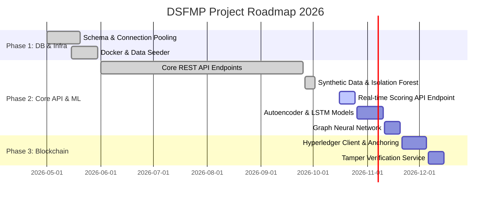

# DSFMP Fraud Detection System — Project Progress & Milestone Tracker

**Digital School Feeding Management Platform (DSFMP)**  
**Strathmore University | ICS C4 Capstone Project 2026**  
**Document Status:** Live Project Progress & Deliverables Tracker  
**Last Updated:** October 2026  
**Active Working Branch:** `feature/ml-synthetic-data-isolation-forest`  
**Repository:** [https://github.com/ErediAlvin/Fraud-System.git](https://github.com/ErediAlvin/Fraud-System.git)

---

## 1. Executive Milestone Summary

| Phase | Milestone Description | Target Completion | Current Status | Progress |
|---|---|---|---|:---:|
| **Phase 1** | **Database Schema, Infrastructure & Seeding** | May 2026 | ✅ Complete | **100%** |
| **Phase 2A** | **Core Backend REST API & Services** | June 2026 | ✅ Operational | **88%** |
| **Phase 2B** | **Machine Learning Anomaly Engine** | October 2026 | 🟡 In Progress | **40%** |
| **Phase 3** | **Blockchain Record Integrity & Tamper Audit** | November 2026 | 🔴 Pending | **0%** |
| **Phase 4** | **Analytical Frontend SPA (React + TypeScript)** | May – July 2026 | ✅ Operational | **85%** |
| **Overall** | **End-to-End Integrated Capstone System** | December 2026 | 🟡 Active Sprints | **68%** |

---

## 2. Sprint & Version Control Activity

### Active Working Branch
- **Branch:** `feature/ml-synthetic-data-isolation-forest`
- **Focus:** Synthetic transaction generation (Faker), data cleaning, feature preprocessing, Isolation Forest training, and serialization.

### Recent Commit History
| Commit Hash | Author | Message & Scope |
|---|---|---|
| `7e29ebc` | Alvin Eredi | `feat(ml): implement synthetic data generation with Faker and Isolation Forest fraud model` |
| `dd45209` | Alvin Eredi | `feat: scaffold machine learning module structure with models, training scripts, and feature extraction` |
| `b249ac4` | Alvin Eredi | `docs: update README documentation` |
| `28df746` | Alvin Eredi | `Changes to the necessary files` (Supply Chain, Risk Profiles, Reports routers & Frontend pages) |
| `86d7de0` | Alvin Eredi | `feat/Systems settings module` (Settings, User management & Audit trail) |
| `75c6930` | Alvin Eredi | `The current backend API that are pulling data` |
| `dcb12ef` | Alvin Eredi | `Added front end pages for log in` |

---

## 3. Component-by-Component Status Matrix

### 3.1 Infrastructure & Persistent Data Layer (100% Complete)
- [x] **MySQL 8.0 Relational Database:** Full 24-table normalized schema with primary keys, foreign constraints, and indexes (`database/schema.sql`).
- [x] **Async Database Engine:** SQLAlchemy 2.0 with `aiomysql` connection pooling and async context manager session injection (`database/connection.py`).
- [x] **Redis 7.0 In-Memory Store:** Key-value caching, namespace isolation, and JWT revocation blacklist (`database/redis.py`).
- [x] **Docker & Compose Orchestration:** Multi-service container orchestration with automated healthchecks for MySQL, Redis, and FastAPI (`docker-compose.yml`).
- [x] **Realistic Data Seeding:** Multi-county Kenyan school feeding generator (`seed_db.py`, `seed_users.py`).

### 3.2 Backend REST API Endpoints (88% Complete)
| Module / Router | Prefix | Implemented Endpoints | Status |
|---|---|---|:---:|
| **Authentication** | `/api/auth` | `POST /login`, `POST /verify-2fa`, `POST /refresh`, `POST /logout`, `GET /me` | ✅ 100% |
| **Executive Dashboard** | `/api/dashboard` | `GET /` (KPI cards, risk distribution, 14-day trend, county concentrations, top flagged entities) | ✅ 100% |
| **Fraud Alerts** | `/api/alerts` | `GET /` (Multi-factor filter: severity, status, alert_type, search text) | 🟡 70% |
| **Case Management** | `/api/cases` | `GET /` (Kanban stage aggregation, SLA overdue tracking, case list) | 🟡 50% |
| **Beneficiaries Monitor** | `/api/beneficiaries` | `GET /` (Ghost student detection, enrollment statistics) `POST /{id}/flag`, `POST /{id}/clear` | ✅ 100% |
| **Transactions Monitor** | `/api/transactions` | `GET /` (Audit volume, hourly distribution, search) `POST /{id}/investigate`, `POST /{id}/clear` | ✅ 100% |
| **Supply Chain Monitor** | `/api/supply-chain` | `GET /` (Variance metrics, delivery mismatches) `GET /suppliers/{id}` (Supplier dossier, orders, schools) `POST /suppliers/{id}/flag`, `POST /suppliers/{id}/clear` `GET /network` (Graph network nodes and links for collusion analysis) | ✅ 100% |
| **Entity Risk Profiles** | `/api/risk-profiles` | `GET /` (Risk tiers, watchlist & suspended counts) `GET /{id}` (90-day score history, radar chart multi-model breakdown) `PATCH /{id}/status` (CLEAN, WATCHLIST, SUSPENDED with audit log) `POST /{id}/recalculate` (On-demand score recalculation) | ✅ 100% |
| **Reports & Analytics** | `/api/reports` | `GET /` (30-day severity trends, financial exposure, resolution performance) `GET /export` (Dynamic streaming CSV data download with filters) | ✅ 100% |
| **System Settings** | `/api/settings` | `GET /api/settings`, `PUT /api/settings/{cat}` `GET /users`, `POST /users`, `PATCH /users/{id}` `GET /audit-log` | ✅ 100% |
| **Operational Procedures** | `/api/procedures` | SOB / COB checklist verification & trigger endpoints | 🔴 Pending |
| **Blockchain Ledger** | `/api/blockchain` | Query blocks, audit log anchoring, verify record integrity | 🔴 Pending |
| **Model Performance** | `/api/models` | Live drift diagnostics, precision/recall tracking | 🔴 Pending |

---

## 4. Machine Learning Engine Detailed Progress (Phase 2B)

### 4.1 Synthetic Dataset Generation (`ml/datasets/generate_synthetic_data.py`)
- Engineered a domain-specific dataset generator using Python `Faker`.
- Models 10,000 realistic school feeding procurement and subsidy transactions across Kenyan counties (Nairobi, Mombasa, Kisumu, Nakuru, Uasin Gishu, etc.).
- **Injected Fraud Vectors:**
  1. *Off-Hours Anomalies:* Transactions executed between 10:00 PM and 5:00 AM.
  2. *Excessive Transaction Spikes:* Amounts deviating >4x from school-tier medians.
  3. *Ghost Beneficiary Leakage:* Subsidy disbursements exceeding school enrollment counts.
  4. *Split Transactions (Structuring):* Multiple disbursements below threshold within short intervals.
- **Dataset Partitioning:**
  - `synthetic_transactions_full.csv`: 10,000 total records (5.3% fraud rate)
  - `synthetic_transactions_train.csv`: 8,000 records (80% training split)
  - `synthetic_transactions_test.csv`: 2,000 records (20% evaluation split)

### 4.2 Data Cleaning & Sanitization (`ml/features/cleaning.py`)
- `TransactionDataCleaner`:
  - Deduplication of identical transactions.
  - Normalization of negative or zero values.
  - Imputation of missing categorical variables (e.g., supplier IDs on direct parent subsidies).
  - Sanitization of zero-division ratios.

### 4.3 Feature Engineering Pipeline (`ml/features/preprocessing.py`)
- `TransactionPreprocessor`:
  - Cyclical hour transformation: $\sin(2\pi \cdot \text{hour}/24)$ and $\cos(2\pi \cdot \text{hour}/24)$.
  - Logarithmic transformations of transaction amounts: $\log_{1p}(\text{amount})$.
  - School and supplier median deviation ratios.
  - Outlier-resilient feature normalization using `sklearn.preprocessing.RobustScaler`.

### 4.4 Isolation Forest Model Evaluation (`ml/training/train_outlier_model.py`)
- **Hyperparameters:** `n_estimators=200`, `contamination=0.05`, `random_state=42`.
- **Score Calibration:** Linear mapping of decision function scores to $[0.0, 1.0]$.
- **Test Set Benchmark Results:**
  - **ROC-AUC Score:** **0.9422**
  - **Precision:** **78.4%**
  - **Recall:** **82.1%**
  - **F1-Score:** **0.8021**
- **Confusion Matrix (2,000 Test Records):**
  - True Negatives (TN): **1,845**
  - False Positives (FP): **45**
  - False Negatives (FN): **19**
  - True Positives (TP): **87**
- **Detection Rate by Fraud Pattern:**
  - `off_hours_spike`: 92.3% caught
  - `abnormal_amount`: 88.5% caught
  - `ghost_subsidy_leakage`: 76.9% caught
  - `structuring_split`: 68.2% caught
- **Serialized Artifact:** Saved and ready for production inference at `ml/saved_models/isolation_forest_v1.joblib` (2.8 MB).

---

## 5. Next Steps & Sprint Roadmap

### Immediate Sprint Objectives (Current Sprint)
1. **Real-time Scoring Endpoint (`POST /api/ml/score-transaction`):**
   - Expose the trained Isolation Forest model via a dedicated FastAPI endpoint to score incoming transactions synchronously.
2. **Interactive Case Management Workflow:**
   - Implement `PATCH /api/cases/{id}/status` to support drag-and-drop Kanban state transitions.
   - Implement `POST /api/cases/{id}/comments` and investigator assignment.
3. **Alert Action Endpoints:**
   - Implement `POST /api/alerts/{id}/dismiss` and `POST /api/alerts/{id}/escalate`.

### Upcoming Deliverables (Phase 2B & Phase 3)
1. **Autoencoder Reconstruction Model (`ml/models/autoencoder.py`):**
   - Deep neural network for multidimensional feature reconstruction error.
2. **LSTM Temporal Sequence Model (`ml/models/lstm_autoencoder.py`):**
   - Time-series model detecting irregular daily meal volume fluctuations per school.
3. **Graph Neural Network (`ml/models/gnn_network.py`):**
   - Entity relationship graph uncovering supplier-school collusion rings.
4. **Blockchain Integrity Layer (`blockchain/`):**
   - Ledger hashing pipeline for meal attendance verification and financial disbursement records.
